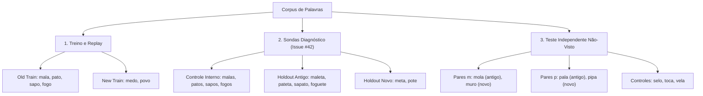

# Protocolo Experimental: Desambiguação Contextual de Entradas com Alvos Conflitantes (Issue #46)

## 1. Identificação e Rastreabilidade

- **Projeto:** Brazwed/Kinera
- **Issue Vinculada:** [#46 — Research — Desambiguação contextual de entradas com alvos conflitantes](https://github.com/Brazwed/Kinera/issues/46)
- **Issues Antecessoras:** [#42 (Etapa A)](https://github.com/Brazwed/Kinera/issues/42) e [#45 (Etapa B)](https://github.com/Brazwed/Kinera/issues/45)
- **Commit Base da Investigação:** `b0502c01ab7d4ce6256fe54e9305d398f10a8702` (Merge do PR #47 na branch `main`)
- **Branch de Pesquisa Isolada:** `research/issue-46-contextual-disambiguation`
- **Ambiente de Execução:** Local CPU (Python 3.12, determinístico, custo zero de nuvem/GPU)
- **Conferência de Integridade:**
  - Branch derivada diretamente de `main` em `b0502c01...`.
  - Zero modificações no núcleo (`src/kinera/`).
  - Runner experimental isolado em `scripts/run_phase46_pilot.py` e resultados em `experiments/phase46_pilot_results.json`.

---

## 2. Pergunta de Pesquisa e Hipóteses

### 2.1 Pergunta Central
> Qual informação adicional, se houver, permite desambiguar entradas com prefixos idênticos e alvos diferentes (`mala/medo`, `pato/povo`) sem vazamento causal, memorização ad hoc ou mudança não declarada da tarefa de inferência?

### 2.2 Diagnóstico da Causa Raiz e Verificação Formal do Regime 1
Na transição `[1]` (`context_size=2`), os campos `context_ids`, `context_syllable_ids` e `context_feature_vectors` são 100% idênticos entre `mala` e `medo` (`['<START>', 'm']`), e entre `pato` e `povo` (`['<START>', 'p']`).
Como verificado formalmente em `tests/test_regime1_identifiability.py`:
- $\|\vec{h}(\text{mala}) - \vec{h}(\text{medo})\|_2 = 0{,}0000\text{e}+00$
- $d_{\text{cos}}(\vec{h}(\text{mala}), \vec{h}(\text{medo})) < 10^{-14}$
- $\|\vec{z}(\text{mala}) - \vec{z}(\text{medo})\|_2 = 0{,}0000\text{e}+00$

Sob pooling determinístico e cabeça linear unívoca, uma função determinística $f(\vec{x}) = \text{argmax}(W\vec{x} + b)$ não pode mapear a mesma entrada $\vec{x}$ para alvos divergentes ($y^*_{\text{mala}} = \text{'a'}, y^*_{\text{medo}} = \text{'e'}$). A convivência funcional no Regime 1 não é um problema de otimização, mas de identificabilidade da entrada.

### 2.3 Hipóteses Investigadas

1. **Hipótese 0 ($H_0$ — Limite Causal no Regime 1):**  
   No regime autoregressivo puro não-condicionado, nenhum atributo subléxico intra-palavra causalmente legítimo gera $d_{\text{cos}} > 0{,}00$ no prefixo `['<START>', 'm']`. Informar a sílaba futura antes da emissão da vogal constitui vazamento causal direto do alvo.
2. **Hipótese 1 ($H_{2b}$ — Desambiguação Condicionada por Lema / Intenção Lexical):**  
   No regime de geração dirigida, a injeção de uma condição lexical discriminativa $\vec{e}_{\text{lemma}}$:
   - Produz separabilidade representacional pré-cabeça: $d_{\text{cos}}(\vec{h}_{\text{mala}}, \vec{h}_{\text{medo}}) \ge 0{,}10$.
   - Restaura a coexistência funcional: $R_{\text{pos}} = 1{,}0000 \land \Delta_{\text{new}} \ge 0{,}0000$ por seed sob predição determinística por $\text{argmax}$.
3. **Hipótese 2 ($H_{\text{ctrl}}$ — Dependência Causal da Condição Lexical):**  
   Sob controle negativo (condição lexical permutada ou removida), o ganho funcional colapsa, confirmando que a desambiguação decorre do sinal lexical específico e não de capacidade residual do modelo.
4. **Hipótese 3 ($H_{\text{gen}}$ — Limites de Generalização):**  
   O condicionamento por ID categórico memoriza lemas conhecidos, mas não transfere para palavras não vistas da partição independente, distinguindo formalmente memorização lexical de generalização morfofonológica.

---

## 3. Regimes de Inferência e Especificação do Condicionamento

### 3.1 Taxonomia de Regimes de Inferência
- **Regime 1: Predição Autoregressiva Pura Não-Condicionada**
  - Entrada: Apenas $c_{<t}$.
  - Distribuição: Estocástica e multimodal ($P(\text{'a'} \mid m) > 0, P(\text{'e'} \mid m) > 0$).
  - Limite: Alvos divergentes não podem ser previstos deterministicamente por argmax a partir da mesma entrada.
- **Regime 2: Geração Condicionada por Lema / Intenção Lexical**
  - Entrada: $c_{<t}$ condicionado à intenção lexical $\mathbf{c}_{\text{lemma}}$: $P(c_t \mid c_{<t}, \mathbf{c}_{\text{lemma}})$.
  - Tarefa: Produção dirigida de uma palavra conhecida (soletrar o lema pretendido).
  - Status Causal: Válido na tarefa de geração dirigida.

### 3.2 Níveis de Representação do Lema
O protocolo diferencia explicitamente três formas de condicionamento:
1. **Identificador Categórico (`lemma_id`):**  
   Lookup table indexada por palavra. Atua como chave de memorização. Não possui composição nem transfere para palavras fora do vocabulário de lemas.
2. **Representação Composicional de Raiz / Morfologia:**  
   Vetor de atributos morfológicos, fonotáticos ou semânticos compartilháveis entre palavras afins (ex: mesma raiz, classe gramatical, sufixação). Pode transferir para novas palavras.
3. **Condição Lexical de Alvo Pretendido:**  
   Informa previamente ao modelo qual palavra deve ser gerada.
   > [!IMPORTANT]
   > A condição lexical resolve o problema da *geração dirigida de uma palavra conhecida*, mas **não demonstra que a Kinera consegue descobrir autonomamente qual palavra é apropriada** em um contexto conversacional aberto sem intenção lexical prévia. Essa distinção deve permanecer explícita em todas as conclusões.

---

## 4. Partições de Dados e Controle de Holdout

Para evitar vazamento metodológico e circularidade, os conjuntos são estritamente segregados:

- **Sondas de Diagnóstico (Issue #42):** Palavras já conhecidas pelo histórico da pesquisa. Servem exclusivamente para medir a estabilidade do conhecimento previamente testado e verificar se a intervenção preserva a baseline histórica. **Não são tratadas como teste de generalização independente.**
- **Partição Independente (Novas Palavras Não-Vistas):** Palavras que jamais participaram do treino, do replay, da calibração de hiperparâmetros ou da seleção de hipóteses. Testam se o modelo transfere ou se apenas consulta identificadores memorizados.

---

## 5. Níveis de Avaliação e Critérios de Decisão Predefinidos

### 5.1 Critérios de Aceitação por Eixo

| Nível | Métrica | Denominador / Fórmula | Limiar Pré-Definido | Interpretação |
|---|---|---|---|---|
| **A. Representacional** | Distância de Cosseno ($d_{\text{cos}}$) | $1 - \frac{\vec{h}_a \cdot \vec{h}_b}{\|\vec{h}_a\|_2 \|\vec{h}_b\|_2}$ | $d_{\text{cos}} \ge 0{,}10$ | Afastamento angular dos vetores pré-cabeça. Não é prova isolada de sucesso funcional. |
| **A. Representacional** | Distância Euclidiana ($d_{\text{euc}}$) | $\|\vec{h}_a - \vec{h}_b\|_2$ | $d_{\text{euc}} > 0{,}0$ | Separação métrica estrita. |
| **B. Coexistência Funcional** | Retenção Positiva ($R_{\text{pos}}$) | Sondas internas positivas ($N_{\text{pos}}=3$) | $R_{\text{pos}} = 3/3 = 1{,}0000$ | Preservação perfeita do conhecimento antigo nas 3 sondas positivas. |
| **B. Coexistência Funcional** | Delta da Tarefa Nova ($\Delta_{\text{new}}$) | $C_{\text{new, post}} - C_{\text{new, acq}}$ ($N_{\text{new}}=2$) | $\Delta_{\text{new}} \ge 0{,}0000$ | Preservação da competência recém-adquirida sem perda pós-replay. |
| **B. Coexistência Funcional** | Log-Loss Conjunto | Média de perda nos pares conflitantes | $\le 1{,}0000$ | Redução contínua de incerteza em relação à baseline ($1{,}1695$). |
| **B. Controle Negativo** | Queda sob Permutação | Comparação: Lema Correto vs. Lema Embaralhado | Colapso de $R_{\text{pos}}$ ou $\Delta_{\text{new}}$ | Comprova dependência causal do sinal lexical. |
| **C. Generalização** | Acurácia Holdout Diagnóstico | Média nas 6 sondas da Issue #42 | $\ge 0{,}8000$ | Preservação das sondas de controle conhecidas. |
| **C. Generalização** | Acurácia Teste Independente | Média nas palavras não-vistas | Medição comparativa | Mede se há transferência real ou memorização por lookup. |
| **D. Regime de Inferência** | Rotulação Taxonômica | Classificação obrigatória | Rigor conceitual | Não confundir geração dirigida com predição não-condicionada. |

### 5.2 Regra de Agregação
- Os limiares funcionais ($R_{\text{pos}} \ge 1{,}0 \land \Delta_{\text{new}} \ge 0{,}0$) são avaliados **individualmente por seed** (`42`, `43`, `44`).
- Uma configuração só é considerada aprovada se **todas as 3 seeds** atenderem aos critérios conjuntamente (`all_seeds_criteria_met == True`). Médias agregadas não serão utilizadas para mascarar falhas individuais.

---

## 6. Configurações Avaliadas no Piloto

1. **Condição 1 — Baseline Não-Condicionada (Regime 1):**  
   Modelo autoregressivo original da Fase 45 ($\text{context\_size}=2$, sem lema). Demonstração do limite de identificabilidade.
2. **Condição 2 — Geração Condicionada por Lema (Regime 2 — $H_{2b}$):**  
   Modelo recebe o vetor de lema correspondente à palavra-alvo como entrada de condicionamento.
3. **Condição 3 — Controle Negativo (Lema Embaralhado / Permutado):**  
   Durante a inferência/avaliação, o vetor de lema é substituído pelo lema do par conflitante (`mala` recebe lema de `medo`). Se o modelo depender causalmente do lema, o acerto deve inverter ou colapsar.
4. **Condição 4 — Teste Independente (Palavras Não-Vistas com Lema Desconhecido):**  
   Avaliação na partição independente com lema mapeado para `<UNK_LEMMA>`, testando o comportamento fora do vocabulário conhecido.
